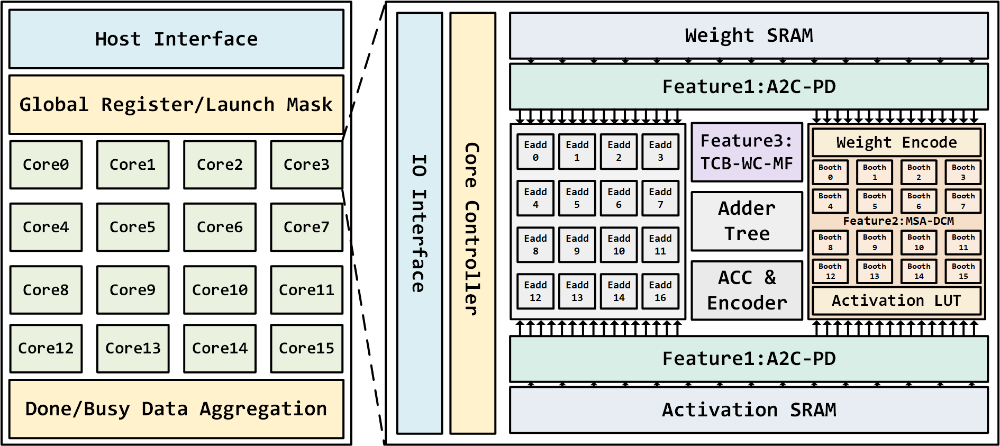

# POSIT-CIM

**面向 POSIT 数据格式的存算一体电路设计研究 · 本科毕业设计材料归档**

SRAM-based digital computing-in-memory with POSIT arithmetic.

本项目围绕 POSIT 的变长编码和尾数稀疏性，探索低开销解码、动态周期乘法与多路指数寻大。论文描述的系统支持 POSIT⟨16,2⟩ 和 POSIT⟨8,2⟩，采用 16 核运算平台，每核包含 16 路并行计算通道。

## 三个核心设计

| 设计 | 解决的问题 | 源码入口 |
|---|---|---|
| **A2C-PD** | 降低 POSIT 补码解码中的转换开销 | [a2c_pd.v](rtl/a2c_pd.v) |
| **MSA-DCM** | 利用尾数与 Booth 编码稀疏性调整计算周期 | [msa_dcm.v](rtl/msa_dcm.v) |
| **TCB-WC-MF** | 通过逐位筛选求多路有符号指数最大值 | [tc_bwc_mf.v](rtl/tc_bwc_mf.v) |

## 阅读入口

- [设计概览](docs/overview.md)：研究动机、数据流和关键模块。
- [文件导航](docs/file-guide.md)：RTL、测试平台、EDA 与分析脚本的用途。
- [复现状态](docs/reproduction-status.md)：缺失文件、环境前提、结果归属和已完成的归档检查。
- [来源对照](docs/source-map.csv)：公开文件与原始目录内相对路径的对应关系。
- [历史 RTL 变体](archive/README.md)：保留不同接口与实现版本，供追溯比较。

## 工程状态

当前仓库是从现有毕设材料中提炼的**部分源码与流程归档**。顶层、控制器、独立存储 wrapper 和实验输入尚未齐备，不能直接运行完整芯片仿真或复现论文结果。具体缺口见[复现状态](docs/reproduction-status.md)。

论文报告：16 核系统完成多工艺角逻辑综合与门级仿真；单个运算核进一步做后端与功耗评估。论文摘要给出的单核能效为 POSIT⟨16,2⟩ **0.07965 TFLOPS/W**、POSIT⟨8,2⟩ **0.1491 TFLOPS/W**。这些是论文中的历史报告值，本次归档未重跑实验，也未独立验证上述数值。

## 材料范围

保留模块 RTL、测试平台、EDA 脚本、精选分析脚本和图表。个人服务器目录已在公开副本中替换为 `/path/to/...`。原始论文、答辩文件、学校流程材料、第三方论文 PDF、授权工艺库和商业工具均不包含在仓库中。

本仓库未附加开源许可证；公开访问不代表另行授予再许可权利。
