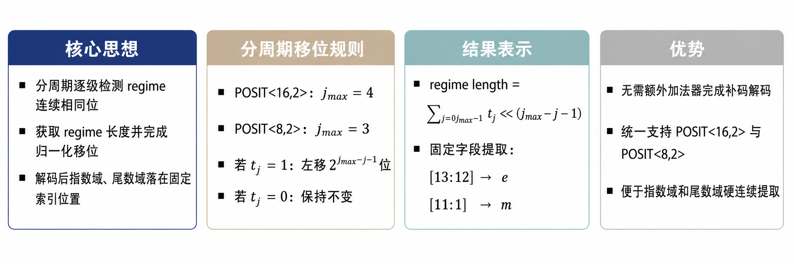
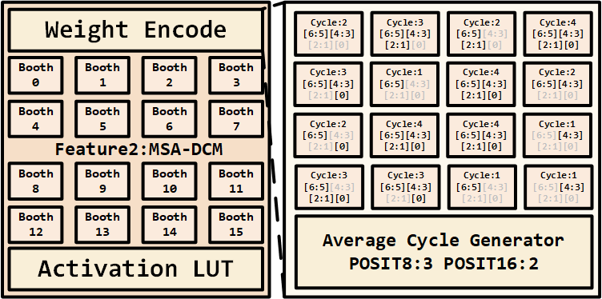
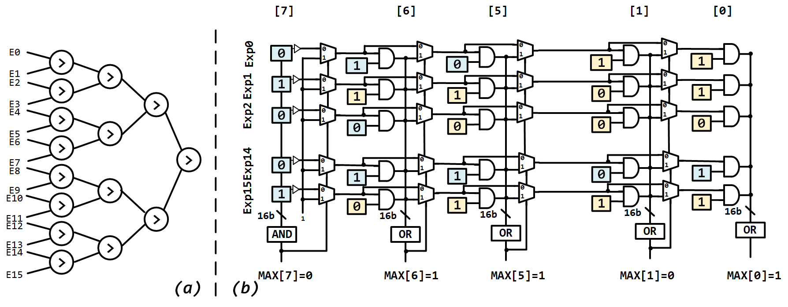
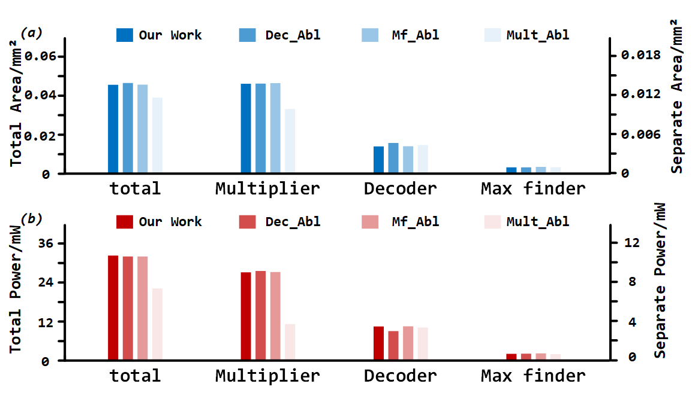

# 设计概览

## 研究问题

POSIT 通过 regime 域和动态尾数长度提供锥形精度。解码、负数补码处理、尾数计算以及多路指数对齐会引入硬件开销。本毕设围绕这些环节设计 SRAM 数字存算一体数据通路。

## 系统与数据流

论文描述一个 16 核运算平台，每个核包含局部激活/权重存储、16 路计算通道、指数对齐与累加、结果编码。支持的格式为 POSIT⟨16,2⟩ 与 POSIT⟨8,2⟩。

```text
原始 POSIT 激活/权重
  → 解码得到指数与尾数
  → 权重 Booth 编码、激活 LUT
  → 动态周期尾数乘法、指数计算与寻大
  → 尾数对齐与加法树
  → 累加与结果重编码
```

这张数据流图描述论文设计意图。仓库中的独立模块尚缺完整顶层连接。

## A2C-PD

入口为 [a2c_pd.v](../rtl/a2c_pd.v)。论文将其称为无加法器二进制补码 POSIT 解码单元，目标是直接处理原始补码码字，减少传统解码中的取反加一和符号转换开销。现有接口包含输入格式选择、数据有效/就绪握手、指数与尾数输出。



## MSA-DCM

入口为 [msa_dcm.v](../rtl/msa_dcm.v)。乘法器接收激活候选值、Booth 部分积编码、零组标识与周期控制。它通过激活/权重双路径握手汇合数据，按动态周期完成尾数乘法。

[weight_encode.v](../rtl/weight_encode.v)、[act_lut_setup.v](../rtl/act_lut_setup.v) 与 [encode_collect.v](../rtl/encode_collect.v) 分别提供权重编码、激活查找和周期统计支撑。



## TCB-WC-MF

入口为 [tc_bwc_mf.v](../rtl/tc_bwc_mf.v)。现有实现接收 16 路指数，输出最大指数及各通道的指数差，采用分阶段的逐位候选筛选结构。它为后续尾数对齐提供基准。



## 结果解读

保留的消融、面积与功耗图用于说明论文的评估组织方式。不同消融设计有不同面积与功耗代价，不能将某一子模块的节省直接当作整体系统的同等收益。高稀疏场景中的能效还依赖有效操作数、固定稠密操作数和功耗统计口径，应配合原始数据与实验配置解释。



以上图片来自现有毕设材料。当前仓库未包含支撑全部图表重绘的原始结果表，本次归档未重算图中的结果。
